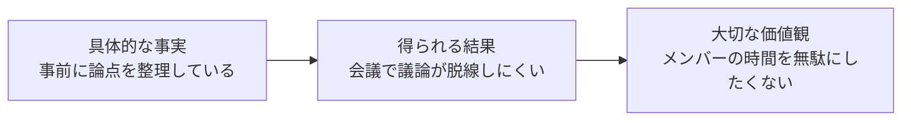
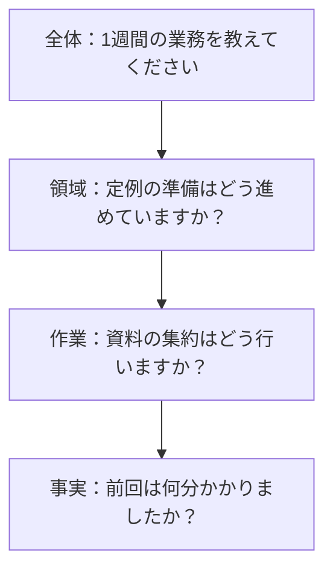

# ヒアリング技法ガイド

部署内の業務課題を見つけ、AIで解決できるテーマを探すためのヒアリング技法をまとめたガイドです。営業のヒアリング技法は、社内ヒアリングに応用する前提で紹介します。

## 目次

1. [基本の考え方](#1-基本の考え方)
2. [用語集](#2-用語集)
3. [課題発見の技法](#3-課題発見の技法)
4. [営業のヒアリング技法](#4-営業のヒアリング技法)
5. [質問と傾聴の基本技術](#5-質問と傾聴の基本技術)
6. [避けたい質問](#6-避けたい質問)
7. [ヒアリングの流れ](#7-ヒアリングの流れ)
8. [実施前後のチェックリスト](#8-実施前後のチェックリスト)
9. [参考文献](#9-参考文献)

---

## 1. 基本の考え方

技法が違っても、次の4点は共通しています。

| 原則 | 内容 | 例 |
|---|---|---|
| **意見より事実** | 感想や予想より、実際に起きたことを聞く | 「便利だと思いますか？」ではなく「前回はどう進めましたか？」 |
| **一般論より具体例** | 普段の話より、直近の1回を聞く | 「普段は？」ではなく「先週の定例準備では？」 |
| **解決策より課題** | AIで何ができるかを話す前に、困りごとを理解する | 「要約AIを入れましょう」ではなく「議事録のどこに時間がかかりますか？」 |
| **話すより聞く** | 相手が話す時間を長くする | 説明や提案は、聞き終えた後に回す |

---

## 2. 用語集

### 2.1 ヒアリング全般

| 用語 | 意味 | この活動での例・注意点 |
|---|---|---|
| **ヒアリング** | 相手から情報や考えを聞き取ること | 目的は「業務の実態と課題を把握すること」と明確にする |
| **インタビュイー / インタビュアー** | 話を聞かれる人 / 話を聞く人 | 部署メンバー / ヒアリング担当者 |
| **ラポール** | 安心して話せる信頼関係 | 最初に目的を伝え、評価の場ではないと明言する |
| **As-Is / To-Be** | 現在の状態 / ありたい状態 | As-Is：毎週手作業で資料を集約する。To-Be：集約は自動化し、確認だけを行う |
| **ペインポイント** | 業務上の苦痛や負担を感じる箇所 | 面倒、時間がかかる、ミスしやすい、気が重いなど |
| **ワークアラウンド** | 問題を避けるための間に合わせの工夫 | 自作のマクロや個人のメモ。課題の大きさを示す重要な手がかり |
| **暗黙知** | 言葉になっていない経験やコツ | 「なんとなく判断している」部分。AI化の難所になりやすい |
| **形式知** | 文書や手順として言葉になっている知識 | マニュアルや判断基準。AIに渡しやすい |
| **定量情報 / 定性情報** | 数値で表せる情報 / 言葉で表す情報 | 週2回・1回60分 / 「毎回気が重い」。両方を集める |
| **一次情報 / 二次情報** | 本人が直接経験した情報 / 人づての情報 | 「隣のチームも困っているらしい」は二次情報なので、本人にも確認する |
| **飽和** | 聞く人を増やしても新しい情報が出なくなった状態 | ヒアリング人数を判断する目安になる |
| **トライアンギュレーション** | 複数の情報源を突き合わせて確かめること | 発言、実際の成果物、作業の観察を照らし合わせる |

### 2.2 インタビューの形式

| 用語 | 意味 | 長所 | 短所 |
|---|---|---|---|
| **構造化インタビュー** | 全員に同じ質問を同じ順番で聞く | 比較しやすい | 想定外の話が出にくい |
| **半構造化インタビュー** | 大枠の質問を決め、話に応じて深掘りする | 比較と発見を両立できる | 聞き手の力量に左右される |
| **非構造化インタビュー** | テーマだけ決めて自由に話してもらう | 想定外の発見が多い | 話が発散し、比較しにくい |

### 2.3 質問の種類

| 用語 | 意味 | 例 |
|---|---|---|
| **オープンクエスチョン** | 自由に答えられる質問 | 「その作業はどう進めていますか？」 |
| **クローズドクエスチョン** | はい / いいえや、選択肢で答える質問 | 「週1回ですか？」 |
| **プローブ** | 回答をさらに掘り下げる追加の質問 | 「例えばどんなときですか？」 |
| **誘導質問** | 特定の答えに導く質問 | 「手作業は大変ですよね？」 |
| **二重質問** | 1つの質問で複数のことを聞く質問 | 「頻度と所要時間を教えてください」 |
| **仮定質問** | 実際には起きていないことを聞く質問 | 「AIがあったら使いますか？」 |

### 2.4 注意したい心理的な偏り（バイアス）

| 用語 | 意味 | 起きること | 対策 |
|---|---|---|---|
| **確証バイアス** | 自分の仮説に合う情報ばかりを集めてしまう | 「やはりAIで解決できる」と聞こえてしまう | 仮説に合わない事実も記録する |
| **社会的望ましさバイアス** | 良く見られそうな答えを選んでしまう | 「特に問題なく回せています」 | 評価の場でないと伝え、具体的な手順を聞く |
| **黙従傾向** | 質問に「はい」と同意しやすくなる | 提案に何でも賛成する | はい / いいえで答える質問を減らす |
| **想起バイアス** | 記憶が偏ったり、変わったりする | 直近の出来事や強い印象ばかりが語られる | 実物の資料や履歴を見ながら聞く |
| **権威バイアス** | 立場の高い人の意見に引きずられる | 上司が同席すると本音を言いにくい | 上司と部下の同席を避ける |
| **ピークエンドの法則** | 最も強い場面と最後の場面の印象で全体を判断しやすい | 「いつも大変」と表現してしまう | 実際の回数や時間を確認する |

### 2.5 優先順位づけ

| 用語 | 意味 | この活動での使い方 |
|---|---|---|
| **定型性** | 手順や判断がどの程度決まっているか | 定型的なほど自動化しやすい |
| **Human-in-the-Loop** | AIの出力を人が確認する仕組み | ミスの影響が大きい業務で検討する |
| **インパクト × 実現性** | 効果と実現しやすさの2軸で評価する方法 | 「効果が大きく、作りやすい」テーマから着手する |

---

## 3. 課題発見の技法

### 3.1 半構造化インタビュー

**概要：** 事前に質問の大枠を用意し、相手の話に応じて順番や深掘りを変える方法です。部署内ヒアリングの基本形になります。

**手順：**

1. 全員に共通で聞く質問を5〜7個に絞ります。
2. 質問ごとに、深掘りの候補を用意します。
3. 本番では順番にこだわらず、相手の話に沿って進めます。
4. 終盤に、聞けていない項目を確認します。

**例：**

```text
共通の質問：最近の1週間の業務を教えてください。
深掘り候補：一番時間を使った作業は？ 予定外に発生した作業は？ 毎週繰り返す作業は？
```

**注意点：** 質問リストの読み上げにならないようにします。一方で話が広がりすぎたら、「先ほどの○○に戻ってもよいですか？」と戻します。

### 3.2 The Mom Test

**概要：** Rob Fitzpatrickが提唱した、顧客インタビューの考え方です。母親のように気を遣ってくれる相手からでも、役立つ情報を引き出せる質問を目指します。

**3つのルール：**

1. 自分のアイデアではなく、相手の生活や業務について話す
2. 将来の仮定や意見ではなく、過去の具体的な出来事を聞く
3. 話すよりも聞く

**質問の変換例：**

| 悪い質問 | 良い質問 | 確認できること |
|---|---|---|
| 「このツールは便利だと思いますか？」 | 「この問題を、前回はどう解決しましたか？」 | 実際の行動 |
| 「課題だと思いますか？」 | 「最後に困ったのはいつですか？」 | 発生頻度と実在性 |
| 「導入したら使いますか？」 | 「解決のために、すでに何か試しましたか？」 | 本気度 |
| 「どのくらい時間を削減したいですか？」 | 「先月は、その作業に何時間かかりましたか？」 | 実際のコスト |

**信頼しにくい3つの情報：**

| 種類 | 発言例 | 対応 |
|---|---|---|
| 褒め言葉 | 「それはいいですね」 | 喜ばず、具体的な業務の話に戻す |
| 一般論や将来の話 | 「普段は」「きっと」「たぶん使います」 | 「最後にそうしたのはいつですか？」と聞く |
| アイデア | 「こういう機能があるといいです」 | 「それがあると、何が解決しますか？」と背景を聞く |

### 3.3 クリティカルインシデント法

**概要：** John C. Flanaganが体系化した方法です。特に成果に影響した出来事を具体的に思い出してもらい、そこから課題や成功要因を分析します。

**手順：**

1. 最近の場面を思い出してもらいます。
2. 状況、当時の行動、結果を順番に聞きます。
3. なぜ印象に残ったのか、次回はどうしたいかを確認します。

**質問例：**

```text
・最近1か月で、特に時間がかかって困った作業はありましたか？
・それはいつ、どんな状況で起きましたか？
・そのとき、具体的に何をしましたか？
・最終的にどうなりましたか？ どこに影響しましたか？
・逆に、想定よりうまく進んだ作業はありましたか？ なぜうまくいったのでしょう？
```

**注意点：** 珍しい事故ばかりが語られる場合があります。「同じことは月に何回くらいありますか？」と頻度を確認します。

### 3.4 コンテクスチュアル・インクワイアリー

**概要：** Hugh BeyerとKaren Holtzblattが提唱した方法です。実際の作業現場で、相手を師匠、聞き手を弟子に見立てて、作業を見せてもらいながら質問します。

**4つの原則：**

| 原則 | 内容 | この活動での例 |
|---|---|---|
| **文脈（Context）** | 実際の環境で観察する | 画面共有で普段の作業を見せてもらう |
| **協力関係（Partnership）** | 対等に作業を理解していく | 「なぜ今そのファイルを開いたのですか？」 |
| **解釈（Interpretation）** | 自分の理解をその場で確認する | 「ここは前回の値と比較している、という理解で合っていますか？」 |
| **焦点（Focus）** | 目的を決めて観察する | 「今日は資料集約の作業に絞って見せてください」 |

**手順：**

1. 普段どおりの作業を見たいと伝えます。
2. 実データの扱いについて確認します。
3. 作業を観察し、切り替えや待ち時間、コピー&ペーストを記録します。
4. 区切りのよいところで質問します。
5. 最後に理解した手順を説明し、誤りを直してもらいます。

**わかりやすいサイン：**

- 複数の画面を行き来している
- 同じ内容を別の場所へ転記している
- 手元のメモや個人用Excelを使っている
- 人に確認するために作業が止まっている
- 説明しにくいが「なんとなく」判断している

### 3.5 Jobs to Be Done（JTBD）

**概要：** 人は道具そのものではなく、ある進歩や目的を達成するために手段を「雇う」と考える枠組みです。Clayton Christensenらにより広く知られました。

**ジョブの3つの側面：**

| 側面 | 問い | 例 |
|---|---|---|
| **機能的** | 実務として何を達成したいか | 定例の論点を事前に整理したい |
| **感情的** | どう感じたいか | 会議で不意を突かれる不安をなくしたい |
| **社会的** | どう見られたいか | 準備が行き届いた進行役でありたい |

**質問例：**

```text
・その資料は、最終的に何のために作っていますか？
・その作業がなくなっても達成できるなら、なくしてもよいですか？
・いつ、どんなきっかけでその作業を始めますか？
・以前はどのような方法でしたか？ なぜ今の方法に変えましたか？
```

**活用のポイント：** 「議事録を自動化する」のような手段ではなく、「決定事項と担当者を漏れなく共有する」のように目的で捉えると、解決策の幅が広がります。

### 3.6 ラダリング

**概要：** 具体的な事実から、結果、価値観へと、はしごを上るように掘り下げる方法です。



**質問例：**

```text
・なぜそこが重要なのですか？
・それができると、どんな良いことがありますか？
・逆に、それができないと何が困りますか？
```

**注意点：** 尋問のように聞こえやすいので、「なぜ」を連続させず、「それができると、どんな良いことがありますか？」と柔らかく言い換えます。

### 3.7 なぜなぜ分析（5 Whys）

**概要：** 問題の原因を「なぜ」で繰り返し掘り下げる方法です。トヨタ生産方式の現場で知られるようになりました。

**例：**

| 段階 | 問い | 答え |
|---|---|---|
| 問題 | - | 定例資料の完成がいつも前日夜になる |
| 1回目 | なぜ遅くなるのか | 各担当者の資料が揃うのが遅い |
| 2回目 | なぜ揃うのが遅いのか | 他の業務があり、依頼を後回しにしやすい |
| 3回目 | なぜ後回しになるのか | いつ、どの粒度で必要なのかが曖昧 |
| 4回目 | なぜ曖昧なのか | 毎回の依頼内容がチャットに分散している |
| 対策案 | - | AI導入より先に、依頼テンプレートの統一を検討する |

この例のように、**原因によってはAIが不要**と判明することも大切な成果です。

**注意点：**

- 5回という回数にこだわらず、対策を考えられる原因まで掘り下げます。
- 人ではなく、仕組みや状況に原因を求めます。
- 原因は1つとは限らないため、枝分かれも確認します。

---

## 4. 営業のヒアリング技法

### 4.1 SPIN

**概要：** Neil Rackhamが、営業商談の調査をもとに提唱した方法です。4種類の質問で、相手自身に課題の重要性を認識してもらいます。

| 質問 | 目的 | 社内ヒアリングの例 |
|---|---|---|
| **Situation（状況）** | 現状の事実を把握する | 「定例の準備はどう進めていますか？」 |
| **Problem（問題）** | 困りごとを見つける | 「その中で、手間がかかるのはどこですか？」 |
| **Implication（示唆）** | 問題の影響を広げて考える | 「準備が遅れると、誰にどんな影響がありますか？」 |
| **Need-payoff（解決の価値）** | 解決した場合の価値を考える | 「準備時間が半分になると、何ができますか？」 |

**ポイント：** 状況質問は調べればわかることを減らし、問題質問と示唆質問に時間を使います。

### 4.2 BANT

**概要：** 営業案件を見極めるための確認項目です。社内では、テーマの実現性の確認に応用できます。

| 項目 | 営業での意味 | 社内での読み替え |
|---|---|---|
| **Budget** | 予算 | 利用料や開発工数を確保できるか |
| **Authority** | 決裁権 | 誰が導入を判断するか |
| **Need** | 必要性 | 本当に困っている人が十分にいるか |
| **Timeline** | 導入時期 | 繁忙期や期限に間に合わせる必要があるか |

**注意点：** 尋問のように聞くと、相手の課題への理解が進みません。課題を深掘りした後で確認します。

### 4.3 MEDDIC

**概要：** 複数の関係者が関わる法人営業で、案件の状況を整理するためのフレームワークです。部署横断で導入するテーマの整理に応用できます。

| 項目 | 営業での意味 | 社内での確認例 |
|---|---|---|
| **Metrics** | 効果を示す指標 | 月に何時間削減できれば成功か |
| **Economic Buyer** | 最終的な予算決定者 | 費用を承認するのは誰か |
| **Decision Criteria** | 判断基準 | セキュリティ、精度、費用のどれを重視するか |
| **Decision Process** | 決定までの手順 | 情報システム部門の審査は必要か |
| **Identify Pain** | 解決すべき痛み | 放置するとどんな影響があるか |
| **Champion** | 社内で推進してくれる人 | テーマを一緒に進めてくれる現場の人は誰か |

### 4.4 使い分け

| 知りたいこと | 使う技法 |
|---|---|
| 課題の大きさを相手と一緒に理解したい | SPIN |
| テーマに着手できる条件を確認したい | BANT |
| 関係者が多いテーマの導入までの道筋を整理したい | MEDDIC |

---

## 5. 質問と傾聴の基本技術

### 5.1 オープンとクローズドの使い分け

話を広げる場面ではオープン、事実を確定する場面ではクローズドを使います。

```text
オープン   ：定例の準備はどう進めていますか？
オープン   ：その中で、手間がかかるのはどこですか？
クローズド ：資料の集約に毎回1時間ほど、という理解で合っていますか？
```

### 5.2 ファネル型の質問

全体から個別へ、徐々に絞ります。



### 5.3 TED

話を引き出すための3つの言い方です。

| 言い方 | 例 |
|---|---|
| **Tell（話してください）** | 「そのときのことを教えてください」 |
| **Explain（説明してください）** | 「その手順を説明していただけますか？」 |
| **Describe（描写してください）** | 「作業の場面を詳しく聞かせてください」 |

### 5.4 プローブの使い分け

| 目的 | 質問例 |
|---|---|
| 具体例を得る | 「例えば、最近ではどんなことがありましたか？」 |
| 数値にする | 「どのくらいの頻度ですか？」「何分くらいですか？」 |
| 判断を知る | 「何を見てそう判断しましたか？」 |
| 例外を知る | 「いつもと違う対応が必要になるのは、どんなときですか？」 |
| 影響を知る | 「それが遅れると、次にどこが困りますか？」 |
| 抽象語を確認する | 「『大変』というのは、どの部分でしょうか？」 |
| 追加情報を促す | 「他に、何かありますか？」 |

### 5.5 アクティブリスニング

Carl Rogersらの来談者中心のカウンセリングを背景に広まった聞き方で、相手の言葉を遮らず、内容と気持ちを理解しようとします。

| 技術 | 内容 | 例 |
|---|---|---|
| **あいづち** | 聞いていることを示す | 「なるほど」「そうなんですね」 |
| **繰り返し** | 相手の言葉をそのまま返す | 「毎週そこで止まるのですね」 |
| **言い換え** | 自分の言葉で確認する | 「つまり、転記が負担なのですね」 |
| **要約** | 区切りでまとめる | 「ここまでの話を整理してもよいですか？」 |
| **感情の受け止め** | 感情を否定せず受け止める | 「それは気を遣いますね」 |
| **沈黙を待つ** | 考える時間を取る | 質問後、数秒は黙って待つ |

---

## 6. 避けたい質問

### 6.1 パターン別の一覧

| パターン | 避けたい質問 | 問題点 | 言い換えの例 |
|---|---|---|---|
| **誘導質問** | 「手作業は大変ですよね？」 | 同意しやすく、本当の評価がわからない | 「その作業をやってみて、いかがですか？」 |
| **仮定質問** | 「AIがあったら使いますか？」 | 実際の行動を予測できない | 「この課題を解決するために、これまで何を試しましたか？」 |
| **将来の予測** | 「今後、効率化したいですか？」 | ほぼ全員が「はい」と答える | 「最近、効率化のために変えたことはありますか？」 |
| **解決策の先出し** | 「議事録は要約AIでいけますよね？」 | 話が解決策に寄り、課題が見えなくなる | 「議事録の作成で、時間がかかるのはどの部分ですか？」 |
| **意見の確認** | 「この業務は重要だと思いますか？」 | 建前の回答になりやすい | 「先週、優先して時間を使った作業は何でしたか？」 |
| **二重質問** | 「頻度と時間と手順を教えてください」 | 答えが一部だけになりやすい | 「まず、頻度はどのくらいですか？」と1つずつ聞く |
| **抽象的な質問** | 「何か課題はありますか？」 | 急には思いつかず、「特にない」となりやすい | 「先週、一番時間がかかった作業は何ですか？」 |
| **普段を聞く質問** | 「普段はどう進めていますか？」のみ | 理想の手順が語られ、例外が抜ける | 「前回の手順を教えてください。普段と違う点はありましたか？」 |
| **責める質問** | 「なぜできていないのですか？」 | 防衛的になり、本音が出にくい | 「進めにくくしている要因は何ですか？」 |
| **「なぜ」の連発** | 「なぜ？ それはなぜ？」 | 尋問に感じられる | 「どんな経緯で今の方法になったのですか？」 |
| **人の評価** | 「○○さんの対応は遅いですか？」 | 人間関係への不安が生じる | 「確認待ちで作業が止まるのは、どんな場面ですか？」 |
| **専門用語** | 「RAGでナレッジを活用できそうですか？」 | 話が通じず、聞きづらい雰囲気になる | 「過去の資料を探すのに困ることはありますか？」 |
| **はい / いいえの連発** | 「週1回ですか？ 1時間ですか？」 | 聞き手の想定の外に話が広がらない | 「どのくらいの頻度で、どのくらいかかりますか？」を順番に聞く |
| **答えの選択肢を狭める** | 「面倒なのは収集ですか、整理ですか？」 | 3つ目以降の答えが出にくい | 「どの工程に手間がかかりますか？」と聞いた後、必要なら選択肢を出す |
| **金額や時間の願望** | 「何割削減したいですか？」 | 根拠のない数値が出やすい | 「先月は実際に何時間かかりましたか？」 |
| **断定しての確認** | 「つまりAIが必要ということですね」 | 聞き手の結論を押し付ける | 「ここまでを整理すると○○と理解しましたが、合っていますか？」 |

### 6.2 良くない質問を言い換える手順

質問を思いついたら、次の順番で確認します。

1. **いつの話か：** 将来の話なら、過去の具体的な場面に変えます。
2. **事実か意見か：** 意見を聞いているなら、行動や数値を聞く質問に変えます。
3. **答えが入っていないか：** 自分の仮説が含まれるなら、中立的な言葉に変えます。
4. **聞いていることは1つか：** 複数あるなら、分けます。
5. **相手は答えやすいか：** 責める表現や専門用語があるなら、言い換えます。

**例：**

```text
元の質問   ：AIで議事録作成を効率化したいですよね？
1. 過去へ   ：前回の議事録作成は、どう進めましたか？
2. 事実へ   ：作成に何分かかりましたか？
3. 中立へ   ：その中で手間がかかった部分はありましたか？
最終形      ：前回の議事録作成はどう進めましたか？ 手間がかかった部分があれば教えてください。
```

### 6.3 相手の反応別の立て直し方

| 相手の反応 | 考えられる理由 | 立て直しの例 |
|---|---|---|
| 「特に困っていません」 | 質問が抽象的、または課題に慣れている | 「では、先週一番時間を使った作業を見せていただけますか？」 |
| 「AIで全部できますよね？」 | AIへの期待が先行している | 「何が楽になると一番助かりますか？ まず今の手順を教えてください」 |
| 「AIは信用できないです」 | 懸念や過去の失敗がある | 「そう感じた場面を教えていただけますか？」 |
| 「いつも大変です」 | 表現が抽象的 | 「直近で特に大変だった回はいつですか？」 |
| 「たぶん週に数回です」 | 正確に把握していない | 「先週は何回ありましたか？ 履歴で確認できますか？」 |
| 体制や人の話が続く | 背景を丁寧に説明している | 「背景がよくわかりました。その中で、ご自身の作業ではどこに一番時間を使いますか？」 |
| 「それは上司に聞いてください」 | 話してよいか不安がある | 「判断の話は別途確認します。ご自身の作業の範囲で教えてください」 |
| 「こんな機能がほしいです」 | 解決策の形で要望している | 「それがあると、どの作業がどう変わりますか？」 |
| 話が止まる | 考え中、または質問が伝わっていない | 数秒待ち、「例えば先週の話でも大丈夫です」と具体化する |

### 6.4 特に注意する場面

| 場面 | 注意点 | 対応 |
|---|---|---|
| **上司が同席する** | 部下が本音を話しにくい | 別々に実施する |
| **同僚の仕事の話になる** | 悪口や評価の話になりやすい | 人ではなく、作業の流れや仕組みの話に戻す |
| **業務削減の話をする** | 自分の仕事がなくなる不安を与える | 「空いた時間で何をしたいか」を中心に話す |
| **機密情報を扱う** | 録音や共有の範囲で問題になる | 事前に確認し、不要な個人名や顧客名は記録に残さない |
| **聞き手が詳しい業務** | 先回りして決めつけやすい | 知っていても「教えてください」と聞く |

---

## 7. ヒアリングの流れ

各技法を、45分のヒアリングに組み合わせた例です。

| 時間 | 段階 | 使う技法 | 質問例 |
|---|---|---|---|
| 5分 | 導入 | ラポール | 「目的は業務を楽にするテーマを探すことで、評価の場ではありません」 |
| 10分 | 全体把握 | 半構造化インタビュー、ファネル型 | 「最近の1週間の業務を教えてください」 |
| 10分 | 課題の発見 | クリティカルインシデント法 | 「最近1か月で、特に時間がかかって困った作業は何ですか？」 |
| 15分 | 深掘り | The Mom Test、SPIN、JTBD | 「前回の手順は？」「遅れるとどこが困りますか？」「何のための作業ですか？」 |
| 5分 | まとめ | 要約、BANTの応用 | 「最も優先したいのは○○という理解で合っていますか？ 実際の作業を見せていただけますか？」 |

優先度が高い業務は、後日コンテクスチュアル・インクワイアリーで作業を観察します。原因を掘り下げるなら、なぜなぜ分析を使います。

### 記録の項目

| 項目 | 記入例 |
|---|---|
| 業務名 | 定例資料の取りまとめ |
| 課題 | 各担当者の資料の収集と体裁の統一に時間がかかる |
| 発言の要点 | 「毎週前日の夜に慌てて確認している」 |
| 頻度 | 週2回 |
| 1回あたりの時間 | 60分（本人申告） |
| 入力と出力 | 入力：チャット、各担当の資料 / 出力：アジェンダ付きの統合資料 |
| 判断の難しさ | 議題の優先度づけには経験が必要 |
| ミスの影響 | 会議の差し戻しと関係者の手戻り |
| 機密性 | 社内情報を含む。社外共有は不可 |
| 既存の工夫 | 共有フォルダと手動の確認リスト |
| 確認状況 | 発言のみ / 成果物で確認済み / 作業を観察済み |

---

## 8. 実施前後のチェックリスト

### 実施前

- [ ] 目的と、話を聞きたい業務の範囲を決めた
- [ ] 質問を5〜7個に絞り、深掘りの候補も用意した
- [ ] 質問が誘導や仮定、二重質問になっていないか確認した
- [ ] 録音、書き起こし、共有範囲の確認方法を決めた
- [ ] 相手の役割や業務を、事前に調べられる範囲で調べた

### 実施中

- [ ] 冒頭で、目的と評価の場ではないことを伝えた
- [ ] 意見ではなく、最近の具体的な出来事を聞いた
- [ ] 頻度と時間を数字で確認した
- [ ] 解決策の話を急がず、課題の理解を優先した
- [ ] 最後に要点をまとめ、相手に確認した
- [ ] 実際の作業を見せてもらえるか相談した

### 実施後

- [ ] 当日中に、事実と自分の解釈を分けて記録した
- [ ] 発言内容を、資料や履歴で確認できるものは確認した
- [ ] 記録の共有範囲と匿名化の要否を確認した
- [ ] 相手に、話の要点と次の予定を共有した
- [ ] 次回の質問を改善した

---

## 9. 参考文献

- Rob Fitzpatrick『The Mom Test』（2013年）
- John C. Flanagan「The Critical Incident Technique」『Psychological Bulletin』（1954年）
- Hugh Beyer, Karen Holtzblatt『Contextual Design』（1997年）
- Clayton M. Christensen ほか『Competing Against Luck』（2016年）
- Thomas J. Reynolds, Jonathan Gutman「Laddering Theory, Method, Analysis, and Interpretation」『Journal of Advertising Research』（1988年）
- 大野耐一『トヨタ生産方式』（1978年）
- Neil Rackham『SPIN Selling』（1988年）
- Carl R. Rogers, Richard E. Farson「Active Listening」（1957年）
